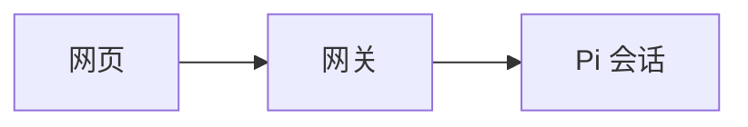

# Mermaid 图表

回复中的 `mermaid` 围栏代码块自动显示为图表，覆盖主聊天、BTW 侧聊及右侧 Markdown 文件预览。无需工具面板或生成服务，已有历史回复刷新后同样可渲染。

````markdown

````

支持 Mermaid 11.17.2 的常规流程图、时序图、状态图、类图等语法。图表按可用宽度缩小，保持原始比例；浅色主题（晴空、薄荷、燕麦、石墨）使用明亮配色，夜间使用深色配色。每张图下方可以展开和复制源码，回复末尾复制仍返回原始 Markdown。

流式输出在代码围栏闭合后才绘图；未闭合的代码仍显示源码。语法错误、超过限额或资源加载失败时显示提示和完整源码，不影响普通消息、发送或工具结果。只渲染 Markdown 代码块，不执行工具输出中的文字。

## 展示与隔离

- `public/pi-file-viewer.js` 的共用 Marked renderer 识别完整 Mermaid 围栏；原有 DOMPurify HTML 清理保留。
- `public/pi-mermaid.js` 只观察 Markdown DOM，串行绘制并丢弃已移除节点的迟到结果。至多缓存16份/约200万字符的布局，只有页面内存，不写会话或浏览器存储。
- Mermaid 在 `sandbox=allow-scripts` 的独立 iframe 内运行，无 allow-same-origin、表单、弹窗或顶层导航权限。框架 CSP 禁止连接、外部图片、字体及额外框架，脚本仅从本机静态文件加载。
- 固定 strict 模式、禁用 HTML 标签布局；不接受 `%%{init...}%%` 等配置指令或 YAML frontmatter。图表不是任意 HTML 或配置执行入口。
- 返回的 SVG 再经 DOMPurify SVG profile 清理，去掉链接、外部图片、foreignObject 等，作为 Blob 图片展示。没有可点击图中链接或回调；不把 SVG 样式嵌入工作台 DOM。Blob 在图片解码后释放。
- 每图源码最多20000字符、最多200条边；资源加载15秒、单图绘制10秒超时后回退源码。超时不能中断浏览器主线程上的所有底层计算，复杂图仍应适当拆分。
- 不新增 REST/RPC 或服务器渲染，不改 Pi 包、模型提示词、历史或媒体数据。运行实例提供相应静态资源后，刷新页面加载。原生 HTML 导出沿用 Pi 上游实现，不受此网页渲染器控制。

## 本地依赖

浏览器离线使用 `public/vendor/mermaid-11.17.2-dompurify-3.4.17.min.js`。它由官方 npm 包 `mermaid@11.17.2` 的 `dist/mermaid.core.mjs` 模块入口重新打包，构建锁精确约束 DOMPurify 3.4.17、KaTeX 0.18.7 和 esbuild 0.28.2；不是上游预构建文件。许可证保留为同目录 `mermaid-LICENSE.txt`，构建保留依赖的许可证注释。主页面按需加载隔离框架，普通无图回复不下载约3.58MB的 bundle。

SHA-256：`7729145a1a32b56f0b6697db4e65f38a900383fd06344cf706701500ec0bd1f5`。

官方11.17.2及当前12.2.0预构建文件仍内嵌旧DOMPurify，单换版本号不能修复该副本。本项目使用官方模块的独立依赖入口构建；不修改上游实现或压缩文件。构建配方和完整锁位于 `scripts/mermaid-build/`，[构建脚本](../scripts/build-mermaid.cjs)核对配方、版本和唯一净化器输入，再输出单个本地文件。两个相同构建的字节一致，静态资源仍在原4MiB压缩预算内。

复现时先创建独立临时目录，将该目录下的 `package.json`、`package-lock.json` 复制进去，运行 `npm ci --prefix /private/fresh-build --ignore-scripts --no-audit --no-fund`，再执行 `node scripts/build-mermaid.cjs /private/fresh-build`。构建目录不使用真实身份或凭据，不覆盖项目Pi依赖。升级时同步配方/锁、文件名、iframe引用、分发清单、此文档与哈希；项目安装图和隔离构建图分别审计，并执行相关浏览器回归。
