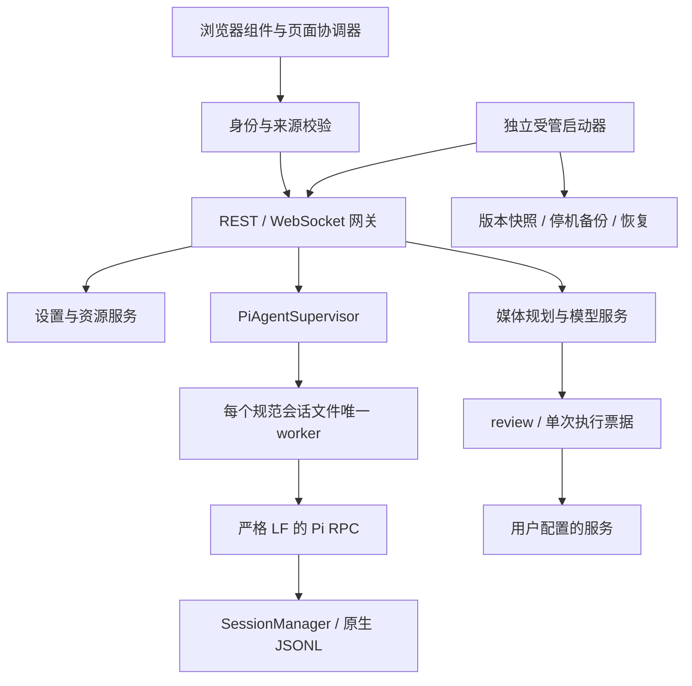

# Pivane 架构

Pivane 是单体部署的 AI 工作台。一个 Express 服务提供同源 REST/WebSocket、浏览器资源和媒体入口；Pi Coding Agent 提供原生会话与工具执行；独立启动器负责受管版本和正常停机。源码按功能服务拆分，运行部署保持简单。

本页用于理解系统边界。查文件和测试用[模块导航](MODULES.md)，追踪具体生命周期、缓存和组件协作用[实现细节](RUNTIME.md)，字段和限额查 [API](../API.md) 与功能契约；验证范围见 [WORKFLOW](WORKFLOW.md)。

## 职责和依赖方向

| 所有者 | 职责 | 详细入口 |
|---|---|---|
| `server.js`、网关与 routes | 装配服务、校验 HTTP/WS、转交操作 | [装配](RUNTIME.md#职责和依赖方向) |
| `PiAgentSupervisor` 与 worker | 唯一 worker、启动互斥、私有命令、回收与停机 | [会话与运行时](RUNTIME.md#会话与运行时) |
| 功能 service / store | 各自的状态、持久化、修订、互斥与失败恢复 | [模块导航](MODULES.md) |
| 浏览器协调器与组件 | 当前页面、连接、草稿、渲染和用户操作 | [浏览器](RUNTIME.md#浏览器) |
| 独立受管启动器 | 安装目录锁、版本指针、维护交接和正常停机 | [安装与维护](RUNTIME.md#安装维护与交付) |

功能服务依赖注入的 store、supervisor、preferences 或公开 Pi SDK。跨服务异步操作在 await 前预占互斥；路由与前端不另存同一份业务状态，也不复制 worker 的生命周期字段清单。

## 会话与运行时

**Pi SessionManager 和原生 JSONL 是唯一会话事实来源。** 项目经 native realpath、配置范围和系统权限解析，持久 worker 按规范 sessionPath 唯一索引；多个浏览器订阅同一 worker，外部 CLI 不能同时写该文件。会话 ID、项目 cwd、文件路径和分支树是不同身份，不能从文件名或正文猜测归属。

RPC 使用 StringDecoder 和严格 LF 分帧，未知或迟到私有响应也要截获。超时、浏览器断线与 `agent_settled` 不代表外部操作或后台任务已经停止；实际 Promise/进程退出才释放对应所有权。界面忙碌、回合空闲、回收与维护空闲由各自投影决定。

持久队列日志保存尚未得到原生完成证明的发送意图；移动、分叉、交付回执保存来源证明和操作身份，均不保存第二份聊天正文。不确定执行不自动重放，恢复不以空队列或文字相等推断消息已发送。分叉、导航、书签和导出沿用原生 entries/branch/labels；JSONL 导出当前分支不能代替完整会话树备份。

具体启动、前缀证明、导航和删除生命周期见[会话实现](RUNTIME.md#会话与运行时)；使用边界见[运行控制](../NATIVE_CONTROLS.md)、[会话工作流](../SESSION_WORKFLOWS.md)、[历史](../HISTORY.md)与[导入导出](../SESSION_TRANSFER.md)。

## 辅助工作与扩展

任务线程是普通持久会话；任务目录、结果回执与线程间消息从原生来源重建，不维护独立聊天历史。侧聊使用内存 SessionManager 和冻结背景，工具确认与关闭生命周期独立，共享项目目录不代表写入隔离。标题、媒体规划和后台学习使用独立的受限调用与各自预算。

pi-subagents 通过受管扩展报告后台活动，Supervisor 用它阻止过早回收或维护；子任务状态不等于主回合忙碌。MCP/Codemode 使用原生连接、执行器和 SDK seam，Pivane 保留工具授权、模型注册表和媒体权限边界，不修改上游包。

档案知识的 HTTP、工具与学习写入共用唯一 `ProfileKnowledgeService`；后台学习引用已核实原生条目，派生 SQLite 索引可以重建。细节见[辅助工作实现](RUNTIME.md#辅助工作与扩展)、[档案设计](AGENT_PROFILES.md)、[记忆契约](../PROFILE_MEMORY.md)与[依赖适配](DEPENDENCIES.md)。

## 外部消息渠道

渠道服务拥有账号连接、固定线程绑定、待发送意图和投递回执；原生会话保存正文与轮次事实。发送前重验允许用户、绑定和原生分支，网络不确定与运行中重启均不自动重放。定时、微信和普通线程结果分别沿用对应轮次的去重凭据；模型输出完成不代表微信已收到。

详见[渠道实现](RUNTIME.md#外部消息渠道)与[消息渠道契约](../MESSAGE_CHANNELS.md)。

## 实例网络

`WorkspaceNetworkService` 管理监听/代理草稿、修订、启动快照和固定目标诊断；`WorkspaceAccessService` 管理工作台认证。保存配置不热切换网络，部署 HOST 覆盖与已识别旧安装规则保持。网络变化不引入自动换线路重发。

配置与实际启动状态分开，见[网络实现](RUNTIME.md#实例网络)及[网络与访问](../ACCESS_CONTROL.md)。

## 文件、配置与身份

Pi Provider 身份与工作台身份独立，认证通过公开 ModelRuntime API；Cookie/Bearer 与 Origin 分别核验。配置保留未知字段，POSIX 私密权限与 Windows 实际 DACL 分别处理。

文件、搜索、用量、备份和恢复复用实际打开描述符的内核路径、完整身份、类型、预算和前后变化校验。Linux `/proc`、macOS `F_GETPATH`、Windows HANDLE 不退化成请求路径检查；原生源码、二进制和 manifest 一起分发。

附件保存私有原件，聊天仅存原生引用。读取、取用、分叉继承与交付资格由当前原生分支和来源证明决定；清理需完整引用扫描及真实 writer 退出，缺失或变化使其失败。工具取得原件不会自动解析、解压或执行。文件预览、独立下载、交付快照和普通项目读取各有预算，不互相代替。

详见[文件与身份实现](RUNTIME.md#文件配置与身份)、[附件契约](../COMPOSER_TOOLS.md)与[文件契约](../FILE_VIEWER.md)。

### 列表元数据与静态传输

会话列表摘要、任务定位、档案搜索索引与压缩静态资源缓存都是可丢弃派生数据。复用前核对各自的文件/目录身份和修订；不完整扫描不能证明对象不存在。用量账本保留无正文的历史计费事实，随身份目录备份，不参与会话恢复。缓存、事务、回退与容量细节见[派生数据实现](RUNTIME.md#列表元数据与静态传输)。

## 浏览器

`pi-chat.js` 协调项目、当前线程、连接与草稿；页面、正文、滚动、工具、文件、侧聊和设置由各组件拥有状态。快照与 live 事件通过 runtime/sequence 衔接，迟到响应按线程、socket 代次、revision 和草稿版本过滤；原生记录最终校正展示。

正文与工具 Markdown 使用 marked + DOMPurify，其余用户/工具文字使用安全 DOM。数学和 Mermaid 输出各自净化；HTML 预览位于隔离 iframe，不能据此声称完全断网。主题、语言和分栏偏好与原生会话数据分离；展示模式不改变模型上下文。

组件责任、按需加载、流式渲染、DOM 复用、缓存预算和资源释放见[浏览器实现](RUNTIME.md#浏览器)。

## 成果中心

成果中心由预算受限的只读来源发现和独立成果库组成。保存取得完整原字节后建立独立 ID，会话删除不删除已保存成果。来源 key 与候选缓存不是授权；写入/删除由持久请求、当前修订和文件证明保护，失败不自动重放。

见[成果实现](RUNTIME.md#成果中心)与[成果中心](../ARTIFACTS.md)。

## 媒体

模型与参数来自实际配置。规划只形成规范方案，执行消费服务器票据；聊天首次执行按已保存的自动生成偏好或本次确认触发，实验室与朗读沿各自授权路径。卡片日志记录尝试和结果，媒体存储保存文件与生成历史。不确定请求不自动重放，跨来源下载不转发凭据。

见[媒体实现](RUNTIME.md#媒体)、[聊天生成](../MEDIA_AGENT.md)、[实验室](../MEDIA_LAB.md)与[接入契约](../MEDIA_CONNECTIONS.md)。

## 安装、维护与交付

开发源码、实际运行 release 与公开归档分别有身份。独立启动器通过私有 IPC 和服务代次处理维护请求，正常停机等待全部登记工作退出；SIGINT/SIGTERM 统一异步清理，重复信号不重跑。

备份保留原始字节、路径、权限与哈希，原路径恢复不冒充目录迁移；不完整恢复阻止启动。发行绑定实际包 SHA256，`scripts/source-files.cjs` 统一发现代码和分发内容，公开文档通过明确清单纳入。实例状态与授权属于私有维护资料，不写进公共架构结论。

具体流程见[实现细节](RUNTIME.md#安装维护与交付)、[发布](RELEASING.md)与[命名和迁移](NAMING.md)。

## 设计取舍与已知技术债

- 保持单体部署和内部功能服务。现有跨模块问题主要来自状态归属和重复规则，没有证据需要增加网络服务边界；也不为缩短文件引入新的前端构建或语言栈。
- 原生 SessionManager、唯一 worker、严格 LF、描述符身份检查与私有票据保护实际数据与执行语义，不能为降低复杂度而减少检查。可重建的展示缓存不成为第二份聊天事实。
- `public/pi-chat.js` 仍集中协调连接、项目列表、当前线程和草稿。修改这些领域时先明确状态所有者再逐个提取组件，并覆盖线程切换、重连和迟到结果；一次性拆散闭包只会扩大验证范围。
- `server.js` 仍包含旧媒体执行器和历史管理。新媒体能力进入 lab/provider 服务；旧入口在明确兼容与停用策略后逐项收敛，不能因默认实验室未启用就删除仍可能被使用的适配器。
- 任务线程查找使用分批元数据目录，缓存不能升级为独立任务历史，不完整扫描不能证明请求不存在；大项目下的扫描预算仍需持续验证。
- 平台原生组件、第三方插件版本适配、持久批量媒体与跨平台会话迁移各有验证成本。合成测试不代表所有真实环境通过，相应限制记录在对应功能或版本说明中。
